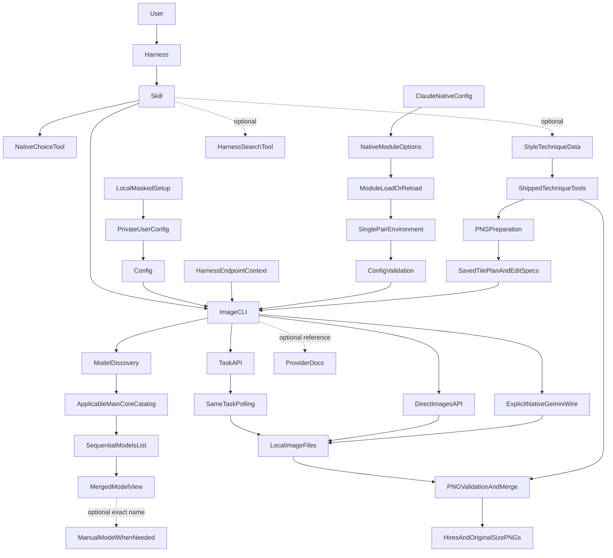
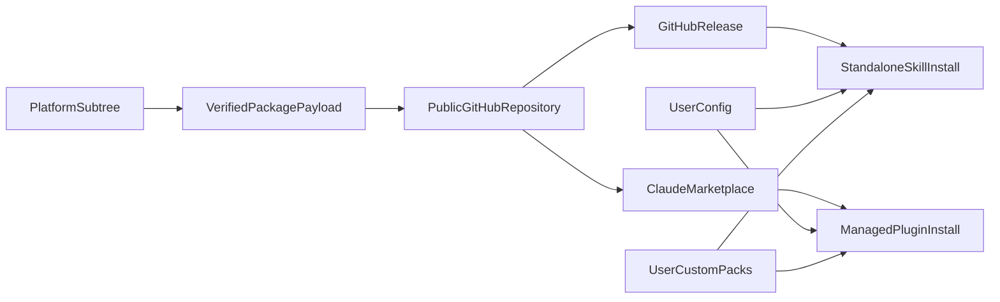

# Nodeclaw-Image-Gen: Structure

> **Current Version:** 0.1.3
> **Status:** v0.1.3 single-pair native module transport source/local verified. Matching release/CI and installed same-session adoption are separate proof layers
> **Session:** b3b4111c-5f9a-4ec7-8bcf-fd76bb593619
> **Textual authority:** [Image-generation tool design](../design/nodeclaw-image-gen.design.md)
> **Full history:** [Design history](../changelog/nodeclaw-image-gen.changelog.md)

## สิ่งที่เครื่องมือนี้เชื่อม

ผู้ใช้คุยกับ text model ใน harness เดิม. Skill ช่วยจัด brief/choice form และ CLI เป็นผู้เรียก API/บันทึกภาพ ไม่เพิ่มบริการฝั่ง server

NativeChoiceTool/HarnessSearchTool หมายถึง tool ที่ harness มีจริง ไม่ใช่บริการที่แพ็กเกจสร้างเอง. ModelDiscovery อยู่ใน CLI เดิม; ลูกศร catalog → models แสดงลำดับการอ่าน ไม่ใช่ server relay. Manual model เป็นทางเลือก ไม่ใช่บังคับผ่าน catalog. Task/Direct เป็นทางเลือก execution เดียวต่อ request ตาม policy ไม่ได้ยิงสองงานขนาน

## ขอบเขต source และ distribution

| พื้นที่ | Owner |
|---|---|
| `<platform-root>/script/Nodeclaw-Image-Gen/` | Canonical source, design และ verification |
| `skills/nodeclaw-image-gen/` | Portable skill/runtime payload เมื่อพัฒนา |
| User config/state directories | Config, request handles, custom packs; ไม่อยู่ใน plugin cache |
| Public repository/release | Distribution ของ checked package เท่านั้น |
| Existing Main Core catalog | NodeClaw public model metadata, ไม่ใช่ inference endpoint |
| PAYG/custom Image API | Generate/Edit execution ที่เลือก |
| Existing NodeNetwork `/docs` | Downstream Add-On & Skill introduction, ไม่ใช่ tool design authority |

Source changes มาจาก canonical subtree. CLI, config/model discovery, Task/Direct execution, local files, content packs และ install/update มี focused/local proof; v0.1.0 public repo/release เผยแพร่แล้วและ OS/Node CI ผ่านทั้งหกเซลล์. Public release download/staging ตรวจ byte parity กับ canonical allowlist แล้ว. Styles กับ techniques เป็นอิสระโดย text model เดิมเลือกและจัด brief; shipped `technique-tools.mjs` และ `raster.mjs` ทำ deterministic preparation/check/colour/merge ด้วย bundled pngjs7 MIT. Tools สร้าง Edit specs ให้ clientเดิม ไม่ส่ง HTTP เอง. Work dir เป็น local images/geometry owner ไม่ใช่ queue/service; executable helpers มากับ full skill release ส่วน content syncยังJSON/Markdownเท่านั้น. Source releaseมี design/changelog/docs/diagram แต่ installercopyเฉพาะ skill root. Previous v0.1.1 local tests26/26, syntax/JSON/package และ Frontendtypecheckผ่านในrevisionนั้น. Historical v0.1.2 full package 37/37 tests ผ่านหลัง user-selected conversion เป็น 55 additional style entries รวม 58 presets; raw collections คง bytes/modes ใน reference-only `references/style-imports/` และไม่มี loader ใหม่. Syntax/JSON, package dry-run, config/native bridge/HTTP/install handoff และ Frontend checks ผ่าน. OS/Node CI ของ revision นี้ดู matching public run ไม่ยืมผลรุ่นก่อน. ไม่มี Telegram/storage upload. Installed native forms, Grok Bot integration, paid Provider requests และ production deployment ยังไม่มี proof ในรอบนี้

Current v0.1.3 configuration path: standalone installer/setup → private user config → existing endpoint/auth boundary; native `userConfig` → `register(on, options)` → module `session.start` on load/reload → one `NODECLAW_IMAGE_GEN_PLUGIN_CONFIG` JSON pair → existing `resolveContext` validation → same CLI/authorization. Native secure storage ยังเป็น authority เดิม; hook ไม่อ่าน store หรือเขียน credential file แต่ child processes เข้าถึง ephemeral key ได้. Old classic writer/dispatch ถอดออก; native-present ingress ignore old address/key/mode exports โดยไม่แก้ export-file bytes. Exact endpoint/proxy-prefix binding กับ Task no-replay คงเดิม. `apiMode=gemini` ยังเป็น explicit Direct wire ไม่แทน Images Google compatibility. Current package proof: 41/41 Node tests, 4/4 native sandbox tests, hook validation และ packaging parity ผ่าน; actual installed session adoption/Windows native acceptance ไม่ได้เกิดจาก diagram หรือ source tests.

Runtime sourceอยู่ `skills/nodeclaw-image-gen/scripts/`: `image-gen.mjs` dispatch → config/model selection → images/tasks → output. `http.mjs` เป็น shared bounded HTTP boundary; content/distributionใช้manifest ownerร่วมกัน. `techniques prepare/check/merge` static-dispatch เข้า `technique-tools.mjs` → `raster.mjs` → vendored `pngjs`; ไม่ execute pathจาก downloaded metadata. `script/`เป็นauthoring/install/release tooling ไม่ใช่serviceใหม่
